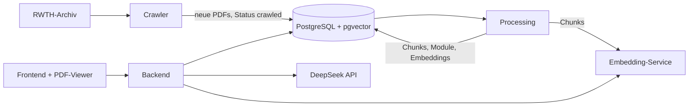
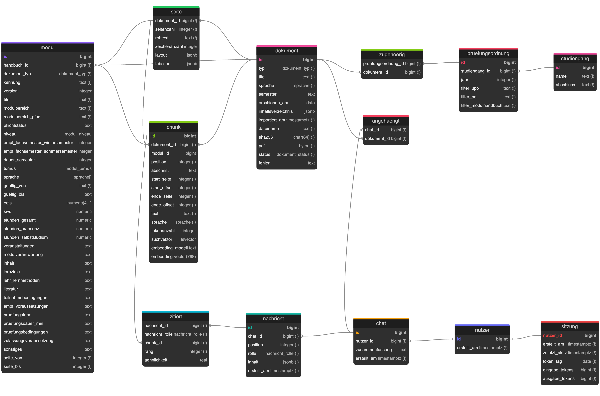

# StuPO-Assistent

Ein RAG-Assistent für Fragen zu Prüfungsordnungen und Modulhandbüchern der RWTH Aachen. Er antwortet nur aus den offiziellen Dokumenten und belegt die Antworten mit Zitaten, die sich per Klick im PDF öffnen.

**Live testen:** https://stupo-assistent.marlinlaja.de

<!-- TODO: Screenshot oder GIF (Frage -> Antwort mit Belegen -> Klick öffnet markierte PDF-Stelle) -->

**Inhalt:** [Motivation](#motivation) · [Architektur](#architektur) · [Tech Stack](#tech-stack) · [Entwicklungsverlauf](#entwicklungsverlauf) · [Pipeline](#die-pipeline-im-detail) · [Learnings](#probleme-und-learnings) · [Agentic Coding](#entwicklung-mit-agentic-coding) · [Grenzen](#grenzen-und-ausblick)

## Motivation

Ich wollte etwas mit angewandter KI bauen, aber nicht als Demo ohne Nutzer, sondern mit echtem Nutzen für Studierende. Prüfungsordnungen und Modulhandbücher gibt es in vielen Versionen und Änderungsordnungen. Die passende Stelle zu einer Frage zu finden ist mühsam, das möchte ich mit diesem Projekt vereinfachen.

Warum nicht einfach ChatGPT oder Claude? Wenn man die richtigen Dokumente selbst heraussucht und hochlädt, funktionieren die großen Modelle teils sogar besser. In meiner Anwendung ist der Aufwand für Nutzer aber kleiner. Man wählt den Studiengang aus und stellt seine Frage. Die Dokumente liegen schon im Kontext, und jede Aussage lässt sich direkt im PDF nachprüfen.

Aktuell sind Bachelor und Master Informatik hinterlegt. Weitere Studiengänge lassen sich ohne Codeänderung sehr einfach ergänzen, mit einem Eintrag in der Datenbank und einem Filter für den Crawler.

## Architektur

| Dienst       | Aufgabe                                                                                      |
|--------------|----------------------------------------------------------------------------------------------|
| `crawler`    | Sucht einmal pro Woche nachts die Dokumente der eingetragenen Studiengänge, vergleicht Hashwerte, speichert neue PDFs |
| `processing` | Prüft stündlich auf neue oder unfertige Dokumente und durchläuft die Pipeline: Parsen, Chunking, Module extrahieren, Embedding |
| `embedding`  | Eigener Service mit quantisiertem ONNX-Modell auf CPU, per API-Key abgesichert                |
| `database`   | PostgreSQL mit pgvector, zusätzlich eine Nur-Lese-Rolle für die SQL-Abfragen des LLM         |
| `backend`    | FastAPI: Recherche-, Antwort- und Zitat-Schritt, Chat-Verwaltung                              |
| `frontend`   | Chat-Oberfläche und PDF-Viewer mit Markierung der Belegstellen                                |

Die Dienste laufen unabhängig voneinander, und jeder bekommt nur die Umgebungsvariablen, die er braucht. Nach außen erreichbar sind das Frontend und aktuell noch die Datenbank (siehe Deployment). Die sechs Container und das Datenbankschema habe ich vorab geplant und das Schema später angepasst, weil zum Beispiel Module inzwischen aus den Modulhandbüchern extrahiert werden, was anfangs nicht vorgesehen war.

### Datenbankschema

### Deployment

Alles läuft auf einem Linux-VPS und wird mit Dokploy verwaltet, was mir viel Konsolenarbeit spart. Das Embedding-Modell läuft lokal auf dem Server, nur das LLM wird per API genutzt. Die Datenbank ist aktuell über einen öffentlichen Port erreichbar und nur per Passwort geschützt. Das macht mir die Verwaltung einfacher, ist aber nicht optimal, aber weil bisher nur öffentliche Informationen drin liegen, habe ich es vorerst so gelassen.

## Tech Stack

| Bereich          | Technologie                                      | Begründung                                                                                               |
|------------------|--------------------------------------------------|----------------------------------------------------------------------------------------------------------|
| Backend          | Python, FastAPI                                  | Standard für ML-nahe APIs, einfache Anbindung des OpenAI-kompatiblen SDKs                                |
| Datenbank        | PostgreSQL + pgvector                            | Relationale Daten, Volltext und Vektorsuche in einem System                                              |
| Embeddings       | jina-embeddings-v5-text-nano, ONNX Runtime (CPU) | Klein genug für den eigenen VPS, in meinen Tests das beste Ergebnis pro RAM                              |
| LLM              | DeepSeek Flash über OpenAI-kompatible API        | Sehr günstig und schnell, in meinen Tests deutlich besser als das anfangs genutzte kleine Mistral-Modell |
| PDF-Verarbeitung | PyMuPDF, tiktoken, py3langid                     | Text und Position je Seite, Token-Zählung, Spracherkennung                                               |
| Frontend         | HTML, CSS, Vanilla JS, nginx                     | Soll übersichtlich und intuitiv sein                                                                     |
| Infrastruktur    | Docker Compose, Dokploy, Linux-VPS               | Einfaches Deployment, ohne alles über die Konsole zu steuern                                             |
| Entwicklung      | Agentic Coding mit Claude Code                   | Siehe [Entwicklung mit Agentic Coding](#entwicklung-mit-agentic-coding)                                  |

## Entwicklungsverlauf

Vor der aktuellen Version gab es mehrere ältere Versionen und Prototypen. Jede hat etwas Neues ausprobiert, und die Erkenntnisse sind in die nächste eingeflossen.

**Erste Version: Naives RAG mit kleinem LLM**

- Feste Struktur: ein Planungs-Aufruf, dann ein Antwort-Aufruf, keine Tool-Aufrufe. Als Testdaten dienten nur ein paar einzelne PDFs.
- Das LLM war `ministral-8b`. Die Antworten waren inhaltlich teils ordentlich. Das Antwortschema passte aber oft nicht, Quellen waren falsch eingetragen und das Reasoning fehlte.
- **Embedding-Vergleich:** Das Modell sollte auf meinem eigenen Server laufen, also musste es klein sein. Verglichen habe ich multilingual-e5-small, multilingual-e5-large und jina-embeddings-v5-text-nano sowie einige größere Modelle per API. Ein starkes LLM hat aus den Dokumenten Testfragen mit erwarteten Abschnitten erzeugt, und geprüft wurde, ob der richtige Abschnitt unter den Top-Treffern landet. Claude Code hat die Testkataloge erstellt und ausgewertet, entschieden habe ich anhand der Daten. Jina war für die Größe am besten. Die großen API-Modelle brachten keinen Gewinn, der den Aufwand rechtfertigt.

**Zweite Version: Stärkere Modelle und Crawler**

- Gleiche feste Struktur, aber stärkere LLMs. Erst kam Mistral Large 3, das bei Einordnung, Zitaten und Anweisungen deutlich zuverlässiger war, aber auf 15 Anfragen pro Minute begrenzt. Dann kam DeepSeek. Das war ein großer Qualitätssprung, bei extrem niedrigen Kosten und guter Geschwindigkeit.
- Das Retrieval füllte ein JSON mit SQL-Abfragen, Stichwort- und semantischer Suche. Für einstufige Fragen reichte das, für zusammengesetzte nicht.
- Neu waren ein automatischer Crawler für das RWTH-Archiv und elf Assistenten-Varianten mit gemeinsamer Schnittstelle, um verschiedene Abläufe zu vergleichen.

**Dritte Version: Prompts vergleichen und dynamisches Retrieval**

- Hier habe ich an der Antwortqualität gearbeitet. Dafür habe ich ein eigenes Vergleichstool gebaut, in dem ich mehrere Prompt-Versionen nebeneinander im Chat testen konnte.
- Die Recherche lief jetzt mit Tool-Aufrufen, danach kam der Antwort-Prompt.
- Zwei Erkenntnisse waren wichtig: Kurze, allgemeine Prompts schlagen lange mit vielen Beispielen, und ein freies Markdown-Antwortformat funktioniert besser als strenge JSON-Schemata pro Satz.

**Aktuelle Version: Saubere Architektur**

- Die Erkenntnisse sind in sechs getrennte Dienste eingeflossen, die Pipeline läuft vollautomatisch vom Crawling bis zum Embedding, und das Ganze ist auf dem VPS deployt.
- Zitieren habe ich in einen eigenen LLM-Schritt ausgelagert. Als der Antwort-Prompt auch die Zitate setzen musste, entstand zu viel Rauschen und die Qualität sank. Jetzt gibt es drei Schritte: Recherche, Antwort, Zitate.
- Der gesamte Code wurde zum Schluss refaktoriert.

## Die Pipeline im Detail

### Ingestion

1. **Crawler** (wöchentlich): holt Dokumente der eingetragenen Studiengänge, vergleicht Hashwerte, legt neue Dokumente mit Status `crawled` an.
2. **Processing** (stündlich): nimmt alle Dokumente, die noch nicht fertig verarbeitet sind. Die Pipeline läuft in den Phasen Parsen, Chunking und Embedding.
3. **Chunking nach Struktur:**
   - Prüfungsordnungen folgen immer demselben Paragraphen-Schema, daran wird logisch geteilt. Lange Paragraphen werden in mehrere Chunks aufgeteilt.
   - Modulhandbücher werden pro Modul geteilt (ein oder mehrere Chunks) und zusätzlich als strukturierte Modul-Tabelle in die Datenbank übernommen.
   - Die passenden regulären Ausdrücke zum Splitten habe ich gemeinsam mit Claude Code entwickelt.

### Recherche-Schritt (agentisch)

Das LLM bekommt die Dokumente und Inhaltsverzeichnisse im aktuellen Kontext und recherchiert mit Tools:

| Tool                   | Zweck                                                              |
|------------------------|--------------------------------------------------------------------|
| `search`               | Semantische Suche für Regeln, Fristen, Abläufe                     |
| `query_modules`        | SQL-Abfragen auf der Modul-Tabelle (Auflistungen, Vergleiche)      |
| `get_module`           | Alle Angaben zu einem Modul                                        |
| `get_section`          | Ganzen Abschnitt einer Prüfungsordnung lesen                       |
| `get_document_index`   | Inhaltsverzeichnis für Dokumente ohne Verzeichnis im Prompt        |
| `get_neighbors`        | Umgebung eines abgeschnittenen Treffers lesen                      |

**Warum SQL?** Modulhandbücher sind zu groß für den Kontext, und Stichwortsuche reicht für Fragen über viele Module nicht, deshalb liegen die Module strukturiert in der Datenbank. Das LLM greift nur über eine **Nur-Lese-Rolle** darauf zu und kann die Daten nicht verändern.

Das Modell darf mehrere Tool-Aufrufe pro Runde absetzen. Hängt der nächste Schritt vom Ergebnis ab, sucht es Schritt für Schritt weiter. Steht zu einem Punkt nichts in den Dokumenten, bricht es nach wenigen Runden ab.

### Antwort- und Zitat-Schritt

- **Antwort:** Das LLM schreibt die Antwort als Markdown, ausschließlich aus den Tool-Ergebnissen.
- **Zitate:** Ein separater LLM-Aufruf sucht für die Aussagen der Antwort die passenden Zitate in den Quellen.
- **Anzeige:** Im Frontend öffnet ein Klick auf einen Beleg das PDF an der Stelle und markiert den Text. Zitate, die nicht wörtlich im Text stehen, werden farblich gekennzeichnet.

Prompts: [backend/assistant/prompts/](backend/assistant/prompts/) (`research.md`, `answer.md`, `cite.md`)

## Probleme und Learnings

**Das größte Problem war die richtige Menge an Information für das LLM.**
Gebe ich zu viel zurück, rutschen Informationen in die Antwort, nach denen nicht gefragt wurde. Sie sind nicht falsch, aber die Antwort wird unpräzise. Gebe ich zu wenig, fehlt Wichtiges. Ich habe über das Vergleichen vieler unterschiedlicher Variationen der Prompts versucht hier einen guten Mittelweg zu finden.

**Weitere Learnings**

- **Kurze Prompts funktionieren besser als lange.** Lange Prompts mit vielen Einschränkungen und Beispielen haben das Modell eher überfordert. Kurze, allgemein formulierte Prompts lieferten bessere Ergebnisse.
- **Aufgaben trennen.** Reasoning und Zitieren im selben Schritt war zu viel. Ein eigener Zitat-Schritt hat die Antwortqualität deutlich verbessert.
- **Freies Markdown statt striktem JSON.** Zu strenge JSON-Schemata pro Satz haben Probleme verursacht. Am Ende war eine einfache Markdown-Antwort robuster.
- **Dynamisches Retrieval statt fester Pipeline.** Mit Tool-Aufrufen bewältigt das Modell auch zusammengesetzte Fragen, die im festen Schema "Retrieval, dann Antwort" scheiterten.
- **Modellwahl ist ein großer Hebel.** Der Wechsel von einem schwachen Mistral-Modell (ministral-8b) zu einem starken DeepSeek-Modell brachte mehr als vieles Prompt-Tuning. Es lag also vor allem an der Modellstärke, nicht am Anbieter.
- **Kleine Embedding-Modelle reichen.** Für diesen Anwendungsfall war ein kleines lokales Modell ausreichend.

**Bekannte Schwächen**

- Das Modell zitiert gelegentlich nicht wörtlich. Der Zitat-Schritt hat das deutlich verbessert. Komplett erfundene Zitate sind selten, aber möglich. Die farbliche Kennzeichnung macht das sichtbar, die Erkennung möchte ich noch verbessern.
- Die Evaluation ist bisher nicht systematisch (siehe [Grenzen](#grenzen-und-ausblick)).

## Entwicklung mit Agentic Coding

Das Projekt ist mit Hilfe von Claude Code entstanden. Architektur, Datenmodell und Aufteilung in Dienste habe ich selbst geplant. Bei der Umsetzung habe ich mit dem Agenten zusammengearbeitet. Ich habe vorgegeben, was als Nächstes passiert, den Code reviewt und einzelne Teile selbst geschrieben. Entscheidungen wie die Wahl des Embedding-Modells habe ich anhand von Daten getroffen, die der Agent geliefert hat. Das Frontend ist weitgehend vibecoded, dort habe ich nur das Design angepasst.

## Grenzen und Ausblick

**Grenzen**

- Bisher nur Informatik (Bachelor und Master), weitere Studiengänge sind nur stichprobenartig getestet.
- Keine systematische Evaluation mit Kennzahlen. Getestet habe ich mit Fragen, die ein starkes LLM (Claude Sonnet) aus den Dokumenten erzeugt hat, und mit eigenen. Das war eher zu wenig.
- Das Frontend ist funktional, aber nicht der Fokus des Projekts.
- Kein Rechtsrat, verbindlich sind immer die offiziellen Dokumente.

**Nächste Schritte**

- Systematische Evaluation mit festem Fragenkatalog und Kennzahlen (Trefferquote, Zitatgenauigkeit)
- Bessere Erkennung und Darstellung nicht wörtlicher Zitate
- Weitere Studiengänge und Fakultäten
- Eventuell weitere Funktionalitäten, wie zum Beispiel Upload eigener persönlicher Dokumente wie einer persönlichen Notenübersicht oder dem Studienverlaufsplan.
